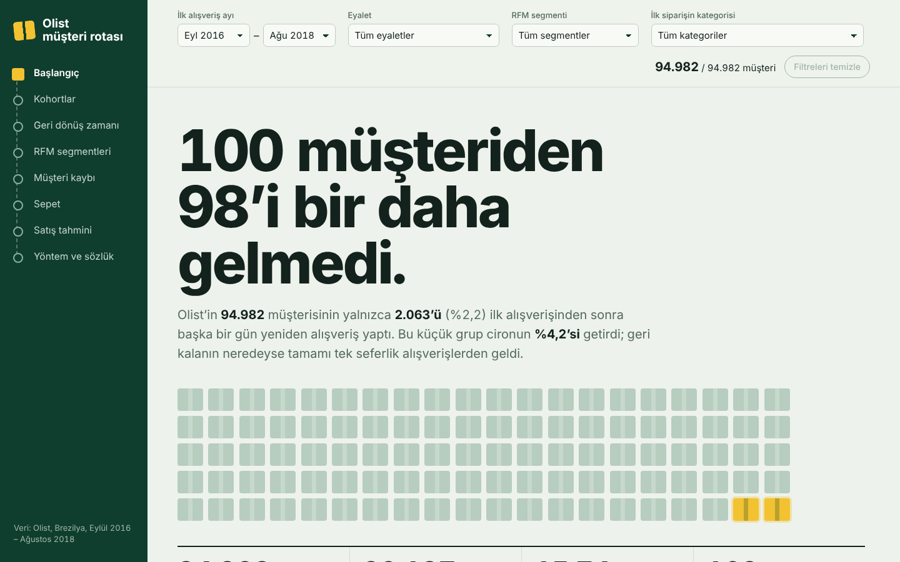
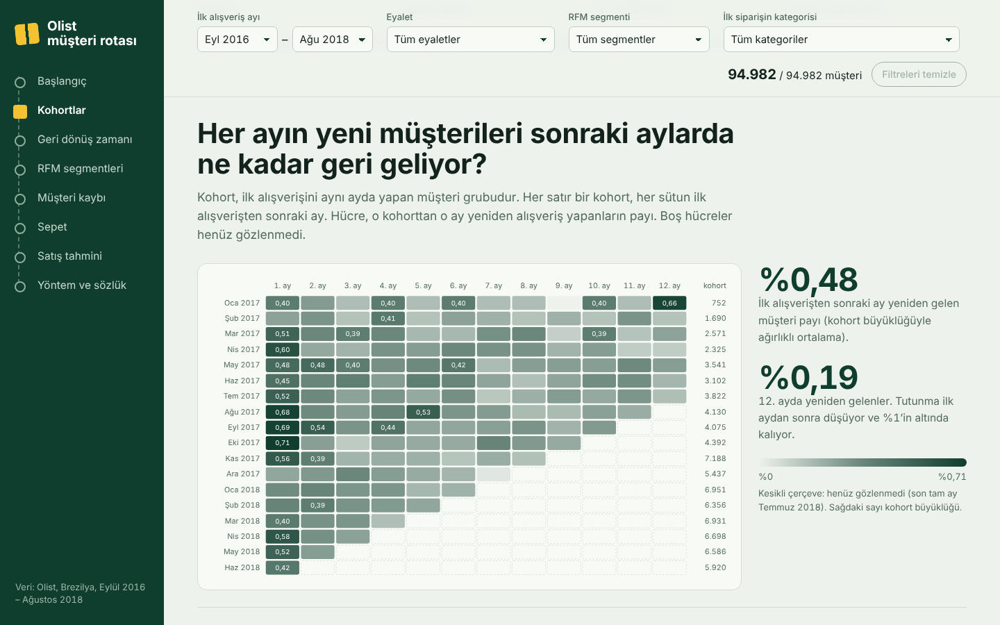
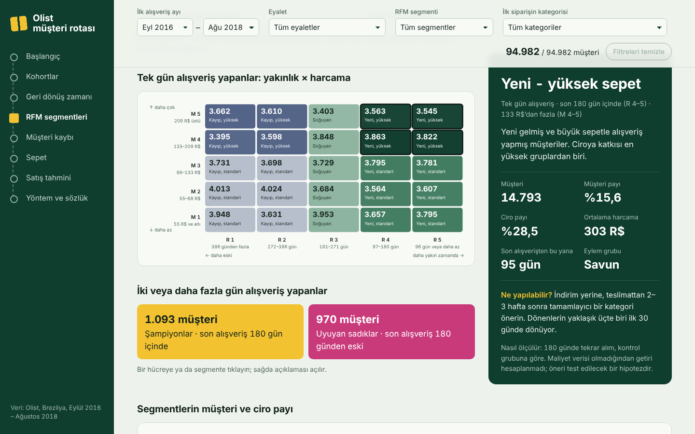
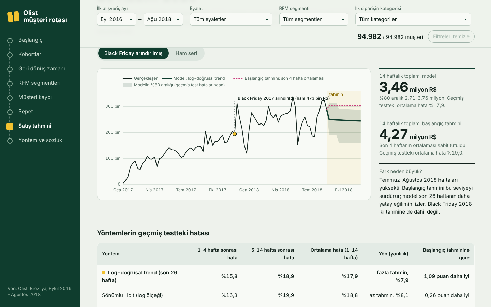

# olist-customer-intelligence

**Canlı uygulama / Live demo: <https://emre-cakir0.github.io/olist-customer-intelligence/>**

Brezilya e-ticaret pazaryeri Olist'in gerçek sipariş verisiyle (98.197 sipariş, 94.982 müşteri) müşteri ve satış
analitiği: kohort analizi, RFM segmentasyonu, müşteri kaybı (churn), sepet analizi ve haftalık satış tahmini.
Tek komutla tüm tablolar, grafikler ve yönetici özeti yeniden üretilir. Sonuçlar tarayıcıda açılan, filtrelenebilir
ve tamamen Türkçe bir web uygulamasında ve bir Streamlit panelinde incelenebilir.



## English summary

A reproducible customer and sales analytics project on the public Olist dataset (98K orders, 95K customers, Brazil,
Sep 2016 – Aug 2018). One command rebuilds every table, chart and the executive summary.

- **Cohorts and retention:** 97.8% of customers bought on a single day only; month-1 retention is 0.48%.
- **RFM segmentation:** 7 segments with explicit rules; two segments hold 30.6% of customers and 56.6% of revenue.
  Each segment is mapped to a testable, control-group-based action (no ROI is claimed: cost data is not available).
- **Churn:** compared at 180 vs 365 days after delivery. Faster delivery is associated with more repeat purchases at
  180 days (2.04% vs 1.38%, Bonferroni-adjusted p = 0.010) but not at 365 days (p = 0.26). A time-ordered logistic
  regression reaches AUC 0.576 against 0.552 for a simple delivery-time rule; the difference is not convincing and is
  reported as such.
- **Basket analysis:** 90.1% of orders contain one item; support, confidence (Wilson intervals) and lift are reported
  with low-sample flags (15 of 17 category pairs have fewer than 30 orders).
- **Forecasting:** weekly revenue, rolling-origin backtest (678 forecasts per method) against a naive baseline;
  85 weeks are not enough to estimate yearly seasonality, and the app says so.
- **Delivery:** Python package with tests (pytest), a Streamlit panel and a dependency-free interactive web app
  (HTML/CSS/JavaScript, hand-drawn SVG charts) published with GitHub Pages.

## Ekran görüntüleri

| Kohortlar | RFM segmentleri | Satış tahmini |
| --- | --- | --- |
|  |  |  |

## İş sorusu

Olist'in müşterileri ne sıklıkla geri dönüyor, geri dönmeyle hangi özellikler ilişkili, hangi kategoriler birlikte
alınıyor ve önümüzdeki haftalarda ne kadar ciro beklenebilir? Sonuçta: **hangi müşteri segmentine ne yapılmalı,
ve bu önerileri veri ne ölçüde destekliyor?**

## Veri kaynağı ve lisans

[Brazilian E-Commerce Public Dataset by Olist](https://www.kaggle.com/datasets/olistbr/brazilian-ecommerce),
Kaggle, **CC BY-NC-SA 4.0** lisansıyla (ticari olmayan kullanım, kaynak gösterme). Kullanılan 7 CSV ve edinme
adımları: [`data/raw/README.md`](data/raw/README.md). **Ham CSV'ler bu depoda yoktur**; çalıştırmadan önce
`data\raw` klasörüne kopyalanmalıdır. Dosyalar eksikse komut hangi dosyaların eksik olduğunu yazar ve durur.

Web uygulamasının `docs/veri.js` dosyası bu veriden türetilmiş özet bilgiler içerir (müşteri kimliği yoktur) ve aynı
lisans koşullarına tabidir. Kod MIT lisanslıdır: [`LICENSE`](LICENSE).

## Proje yapısı

```
olist-customer-intelligence/
├── run_pipeline.py          tek çalıştırma komutu
├── requirements.txt
├── olist_ci/                analiz paketi
│   ├── config.py            yollar, tarihler, eşikler (tüm tanımlar burada)
│   ├── data.py              yükleme, temizleme, sipariş/kalem/müşteri tabloları
│   ├── cohort.py            kohort tutunma matrisi, N gün içinde tekrar alım
│   ├── rfm.py               RFM puanları ve segment kuralları
│   ├── churn.py             churn popülasyonu, etkenler, 180/365 gün, model ve başlangıç modeli
│   ├── basket.py            destek, güven, lift
│   ├── forecast.py          haftalık seri, modeller, geriye dönük test
│   ├── plots.py             grafikler
│   ├── report.py            yönetici özetini sonuçlardan üretir
│   └── pipeline.py          adımları sırayla çalıştırır
├── app/panel.py             Streamlit yönetici paneli
├── docs/                    web uygulaması (GitHub Pages bu klasörü yayınlar)
│   ├── index.html, stil.css, uygulama.js
│   ├── veri.js              proje çıktılarından üretilmiş uygulama verisi
│   └── veri_hazirla.py      veri.js'i yeniden üretir
├── tests/                   otomatik kontroller (pytest)
├── data/raw/                ham CSV'ler (Git dışı)
├── data/processed/          hattın ara dosyaları (Git dışı)
├── outputs/tables/          CSV tablolar + sonuclar.json
├── outputs/figures/         PNG grafikler
├── reports/                 yönetici özeti, v1 karşılaştırması, sunum (.pptx)
└── arsiv/v1_olist_analiz/   ilk sürümün kodu, tabloları ve grafikleri (değiştirilmedi)
```

## Web uygulaması

Canlı sürüm: <https://emre-cakir0.github.io/olist-customer-intelligence/>. Yerelde açmak için `docs\index.html`
dosyasına çift tıklamak yeterlidir; kurulum gerekmez.

- Filtreler: ilk alışveriş ayı, eyalet, RFM segmenti, ilk siparişin kategorisi. Başlangıç, kohort, geri dönüş süresi
  ve RFM bölümleri seçili müşteriler için tarayıcıda yeniden hesaplanır.
- RFM bölümünde puan sınırları, tıklanabilir yakınlık × harcama ızgarası ve her segmentin açıklaması, önerisi ve
  ölçütü vardır.
- Churn için 180/365 gün, etken seçimi ve anlamlılık testleri; tahmin için Black Friday'i ham ya da arındırılmış
  gösterme seçeneği.
- Tüm kategori ve eyalet adları Türkçedir; sözlük bölümü terimleri açıklar.

Proje çıktıları değişirse uygulama verisini yenileyin: `python docs\veri_hazirla.py .`

## Kurulum (Windows PowerShell)

Python 3.10 veya üstü gerekir (3.11/3.12 önerilir).

```powershell
cd <proje klasörü>
python -m venv .venv
.\.venv\Scripts\Activate.ps1
python -m pip install --upgrade pip
pip install -r requirements.txt
```

`Activate.ps1` "running scripts is disabled" hatası verirse:
`Set-ExecutionPolicy -Scope CurrentUser RemoteSigned`, sonra etkinleştirme komutunu tekrarlayın.

## Çalıştırma

```powershell
# 1) Ham CSV'leri data\raw klasörüne koyun (bkz. data\raw\README.md)
# 2) Tüm analizleri, tabloları, grafikleri ve raporu yeniden üretin (~30 sn)
python run_pipeline.py

# 3) Otomatik kontroller
python -m pytest

# 4) Streamlit paneli (tarayıcıda http://localhost:8501 açılır)
streamlit run app/panel.py
```

Ham veri başka bir klasördeyse: `python run_pipeline.py --veri-klasoru D:\veriler\olist`.

### Otomatik kontroller

- `tests/test_birim.py`: elle kurulmuş küçük bir veri setinde tanımları sınar (geçerli sipariş filtresi, aynı gün
  siparişin tekrar alım sayılmaması, kohort ataması ve gözlenmemiş hücreler, RFM puanları, churn etiketi ve
  penceresi, destek/güven/lift, geriye dönük testin geleceği görmemesi, WAPE).
- `tests/test_gercek_veri.py`: sipariş, müşteri ve ciro sayılarını ana hattan bağımsız olarak ham CSV'lerden yeniden
  hesaplar; segmentlerin, kohortların, churn eşiklerinin, sepet çiftlerinin ve tahmin serisinin tutarlılığını ve
  raporun güncel sayıları içerdiğini kontrol eder. Ham veri yoksa atlanır.
- `tests/test_panel.py`: Streamlit kuruluysa paneli açar ve hata vermediğini kontrol eder.

## Analiz tanımları

| Konu | Tanım |
| --- | --- |
| Geçerli sipariş | Durumu `canceled`/`unavailable`/`created` olmayan, kalemi ve ödemesi bulunan, 31.08.2018'e kadar verilmiş sipariş |
| Müşteri | `customer_unique_id` (`customer_id` her siparişte değişir) |
| Ciro | Sipariş ödemeleri toplamı (kargo dahil), R$ |
| Tekrar alım | İlk alışveriş gününden sonraki bir günde verilen sipariş; aynı gün ek sipariş = sepet bölünmesi |
| Gözlem sonu | 21.08.2018: veri 22 Ağustos'tan sonra azalıyor; geri dönüş pencereleri bu günde biter |
| Kohort | Müşterinin **ilk sipariş ayı** (2017-01 – 2018-06); son tam ay 2018-07, gözlenmemiş hücreler boş |
| RFM | Tarih **01.09.2018**. R = son alışverişten geçen gün, F = farklı alışveriş günü, M = toplam ödeme. R ve M beşli dilim (5 = en iyi); F yalnızca 1 / 2+ (müşterilerin %97,8'inde F = 1). Segment kuralları `olist_ci/rfm.py` |
| Churn | İlk siparişin **teslimatından** sonraki W gün içinde yeniden alışveriş yapmamak; W = **180 ve 365** gün karşılaştırılır. Penceresi gözlem sonundan önce kapanmayanlar ve teslimattan önce yeniden alanlar dışarıda |
| Churn modeli | Lojistik regresyon; zaman sıralı doğrulama (180 g: teslimat ≤31.10.2017 eğitim, sonrası test; 365 g: ≤31.05.2017). Başlangıç modeli: "teslimat ne kadar kısaysa geri dönüş o kadar olası" kuralı ve rastgele tahmin (AUC 0,5) |
| Sepet | Sipariş = sepet, ürün kategorisi düzeyi. Destek, güven A→B (%95 Wilson aralığı), tüm siparişlere ve çok kategorili sepetlere göre lift; 30'dan az siparişli çiftler "düşük örneklem" |
| Tahmin | Haftalık ciro (2017-01-02 – 2018-08-13, 85 hafta), Black Friday 2017 olay olarak ayrılır; kayan başlangıçlı geriye dönük test (1–14 hafta); başlangıç tahmini: son 4 haftanın ortalaması |

## Bulgular

Tüm sayılar ve kaynak tabloları: [`reports/yonetici_ozeti.md`](reports/yonetici_ozeti.md) (her çalıştırmada
yeniden yazılır).

- **Ciro yeni müşteriden geliyor.** 94.982 müşterinin %97,8'i yalnızca bir gün alışveriş yapmış; Ocak–Temmuz 2018
  cirosunun %97,4'ü ilk alışveriş gününden.
- **Değer iki segmentte.** "Yeni - yüksek sepet" ve "Kayıp - yüksek değerli" müşterilerin %30,6'sı, cironun %56,6'sı.
- **Churn eşiği sonucu değiştiriyor.** Teslimattan sonra 180 günde tekrar alım %1,79, 365 günde %3,11. Kısa teslimatla
  daha yüksek geri dönüş ilişkisi 180 günde anlamlı (%2,04 vs %1,38, düzeltilmiş p = 0,010), 365 günde anlamlı değil
  (p = 0,26).
- **Churn modeli zayıf.** AUC 0,576; basit teslimat kuralı 0,552; güven aralıkları örtüşüyor.
- **Sepetler küçük.** Siparişlerin %90,1'i tek kalemli, %0,8'i çok kategorili; 17 kategori çiftinin 15'i 30'dan az
  siparişe dayanıyor.
- **Tahmin belirsiz.** 20.08–25.11.2018 için en iyi model R$3,46 milyon (%80 aralık R$2,71–3,76 milyon), başlangıç
  tahmini R$4,27 milyon; geriye dönük test farkı 1,1 puan. 85 hafta mevsimsellik için yetersiz.

Sunum: [`reports/Olist Tek Seferlik Müşteri Ekonomisi.pptx`](reports/) (15 slayt, konuşmacı notlu).

## Sınırlılıklar

- Maliyet, marj ve edinim maliyeti yok: getiri (ROI) hesaplanmadı; öneriler kontrol gruplu denemeyle ölçülmeli.
- Churn bulguları ilişkidir, nedensellik değildir; model bireysel hedefleme için yeterli değil.
- Veri 22 Ağustos 2018'den sonra eksik; tahmin serisi 85 hafta, Black Friday tek gözlem.
- Müşteri kimliği pazaryerleri arasında eşleşmiyorsa tekrar alım olduğundan düşük görünebilir; bu veriden ayırt edilemez.

## Başka bir perakendeciye uyarlama

Sonuçlar Olist'e aittir ve başka şirketlere genellenmemelidir. Aynı yapıyı başka bir perakendecide kurmak için
gereken ek veriler (maliyet/marj, kampanya kayıtları, edinim kanalı, iade, SKU kataloğu, sadakat kimliği) ve
uyarlamalar (sıklığa göre churn eşiği, ürün düzeyinde sepet, iki yıllık seriyle mevsimsel tahmin) yönetici
özetinin son bölümünde listelenmiştir.

## İlk sürüm

İlk analizin betikleri ve çıktıları `arsiv/v1_olist_analiz/` içinde değiştirilmeden duruyor. Yeni sürümde değişen
sayılar ve nedenleri: [`reports/v1_karsilastirma.md`](reports/v1_karsilastirma.md).
